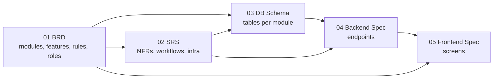

# ADB — Application Design Book Templates

Templates and guidelines for documenting an application as an **Application Design Book (ADB)**: five linked documents that take a project from business requirements to frontend screens.

| #   | Book                                          | Answers                                                                              | Template                                                       | Guideline                                                                    |
| --- | --------------------------------------------- | ------------------------------------------------------------------------------------ | -------------------------------------------------------------- | ---------------------------------------------------------------------------- |
| 01  | **BRD** — Business Requirements               | Why, who, which modules and work, scope, limitations                                 | [templates/01-BRD.md](templates/01-BRD.md)                     | [guidelines/01-BRD.guide.md](guidelines/01-BRD.guide.md)                     |
| 02  | **SRS** — Software Requirements Specification | Quality targets, architecture, workflows, security, infrastructure, recovery targets | [templates/02-SRS.md](templates/02-SRS.md)                     | [guidelines/02-SRS.guide.md](guidelines/02-SRS.guide.md)                     |
| 03  | **DB Schema**                                 | One ERD, then each table as SQL + data dictionary                                    | [templates/03-DB-SCHEMA.md](templates/03-DB-SCHEMA.md)         | [guidelines/03-DB-SCHEMA.guide.md](guidelines/03-DB-SCHEMA.guide.md)         |
| 04  | **Backend Spec**                              | Route catalog, response codes, ownership rules, details for non-standard endpoints   | [templates/04-BACKEND-SPEC.md](templates/04-BACKEND-SPEC.md)   | [guidelines/04-BACKEND-SPEC.guide.md](guidelines/04-BACKEND-SPEC.guide.md)   |
| 05  | **Frontend Spec**                             | Brand colors, sitemap (page tree), screens, special UI behavior                      | [templates/05-FRONTEND-SPEC.md](templates/05-FRONTEND-SPEC.md) | [guidelines/05-FRONTEND-SPEC.guide.md](guidelines/05-FRONTEND-SPEC.guide.md) |

Shared standards for every project: [CONVENTIONS.md](CONVENTIONS.md). Generating an ADB from a prototype with AI: see [PROMPT.md](PROMPT.md).

---

## Shared conventions

Everything that is the same in every project lives in **[CONVENTIONS.md](CONVENTIONS.md)**: the target stack (Next.js + shadcn/ui + Tailwind + ESLint, Express + TypeScript + Zod, PostgreSQL), database naming, the API contract (endpoint pattern, request bodies, response envelope, response codes), backend and frontend folder structure, design token rules, and delivery standards (pipeline, monitoring, backups, security, testing).

The books link to it instead of copying it. A project changes a convention only with an ADR in ADB 02 §13.

---

## How the books link



Write them in order: 01 → 02 → 03 → 04 → 05. Downstream books reference upstream IDs; they never invent new features or roles.

## ID scheme (shared across all books)

| ID                         | Defined in    | Example   | Meaning                                                       |
| -------------------------- | ------------- | --------- | ------------------------------------------------------------- |
| `OBJ-NN`                   | BRD 1.3       | OBJ-01    | Business objective                                            |
| `PER-NN`                   | BRD 2.2       | PER-02    | Persona (optional)                                            |
| `ROLE-NN`                  | BRD 2.1       | ROLE-01   | User role                                                     |
| `<CODE>`                   | BRD 4.1       | PRJ       | Module code (2–4 letters)                                     |
| `F-<CODE>-NN`              | BRD 4.2       | F-PRJ-03  | Feature (work item)                                           |
| `BR-<CODE>-NN` / `BR-X-NN` | BRD 4.2 / 4.3 | BR-PRJ-01 | Business rule (module / cross-module)                         |
| `IS-NN` / `OS-NN`          | BRD 5         | OS-02     | In scope / out of scope item                                  |
| `LIM-NN`, `A-NN`, `C-NN`   | BRD 6         | A-03      | Limitation, assumption, constraint or dependency              |
| `R-NN`                     | BRD 8         | R-01      | Risk                                                          |
| `NFR-NN`                   | SRS 1         | NFR-02    | Non-functional requirement                                    |
| `WF-NN`                    | SRS 3.1       | WF-04     | Workflow                                                      |
| `JOB-NN`                   | SRS 3.4       | JOB-01    | Background job                                                |
| `DF-NN`                    | SRS 4         | DF-03     | Data flow                                                     |
| `INT-NN`                   | SRS 5         | INT-01    | Integration                                                   |
| `ADR-NNN`                  | SRS 13        | ADR-002   | Architecture decision                                         |
| `EP-<CODE>-NN`             | Backend 7     | EP-PRJ-04 | Endpoint                                                      |
| `SC-NN`                    | Frontend 5.1  | SC-07     | Screen                                                        |
| `Q-NN`                     | Any book      | Q-12      | Open question — **one global sequence** across all five books |

## Naming that flows through every book

Decide module names once in BRD §4.1. The same name appears everywhere:

| Where                                       | Form               | Example (`Milestone Task`)               |
| ------------------------------------------- | ------------------ | ---------------------------------------- |
| BRD module code                             | UPPERCASE          | `MTK`                                    |
| URL segment / BE folder / FE feature folder | camelCase singular | `milestoneTask`                          |
| DB table                                    | snake_case plural  | `milestone_tasks`                        |
| Path param                                  | `<module>Id`       | `:milestoneTaskId` / `[milestoneTaskId]` |
| Response code prefix                        | UPPER_SNAKE        | `MILESTONE_TASK_…`                       |
| TS type                                     | PascalCase         | `MilestoneTask`                          |
| API wrapper                                 | `<action><Entity>` | `searchMilestoneTask.ts`                 |

## Writing rules (all books)

Every section in a template is tagged:

| Tag          | Meaning                                                                                              |
| ------------ | ---------------------------------------------------------------------------------------------------- |
| **Core**     | Always fill.                                                                                         |
| **Optional** | Fill only if it applies to this project; otherwise leave the section out. |
| **Standard** | Follows [CONVENTIONS.md](CONVENTIONS.md). Write it only when the project differs (each difference needs an ADR); otherwise leave it out. |

Untagged subsections follow their parent's tag.

1. **Keep it simple.** Plain words, short sentences, tables and bullets instead of paragraphs. A small app gets short books.
2. **One home per fact.** Write each fact once, in the book that owns it, and reference it elsewhere (e.g. permissions live only in BRD §4.4; endpoints only in Backend §7; response codes only in Backend §5.1).
3. Keep every Core heading, all section numbers, and every table column. Sections you leave out are listed in Document Info → *Sections left out*, so readers know they were skipped on purpose; never renumber the rest.
4. Replace every `[placeholder]`.
5. Write `TBD — see Q-NN` when something is unresolved, and add Q-NN to that book's Open Questions.
6. Mark unverified content `(Assumption A-NN)` and list it in BRD §6.2.
7. Use Mermaid for every diagram.
8. Bump the version and add a change log row on every meaningful change.

## Repository layout

```text
.
├── README.md                       # This file
├── CONVENTIONS.md                  # Shared standards every book links to
├── PROMPT.md                       # AI prompt: prototype → ADB with business-view interview
├── templates/
│   ├── 01-BRD.md
│   ├── 02-SRS.md
│   ├── 03-DB-SCHEMA.md
│   ├── 04-BACKEND-SPEC.md
│   └── 05-FRONTEND-SPEC.md
└── guidelines/
    ├── 01-BRD.guide.md
    ├── 02-SRS.guide.md
    ├── 03-DB-SCHEMA.guide.md
    ├── 04-BACKEND-SPEC.guide.md
    └── 05-FRONTEND-SPEC.guide.md
```

## Using with an AI assistant

Give the assistant the **raw** file URLs so it reads plain Markdown instead of GitHub's HTML page:

```text
https://raw.githubusercontent.com/prame-dot-exe/gcb-adb-templates/main/templates/01-BRD.md
https://raw.githubusercontent.com/prame-dot-exe/gcb-adb-templates/main/guidelines/01-BRD.guide.md
```

[PROMPT.md](PROMPT.md) already lists all twelve files (README, CONVENTIONS, 5 templates, 5 guidelines) with these links.
