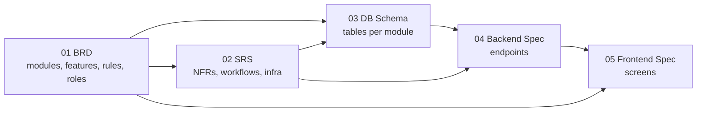

# ADB — Application Design Book Templates

Templates and guidelines for documenting an application as an **Application Design Book (ADB)**: five linked documents that take a project from business requirements to frontend screens.

| # | Book | Answers | Template | Guideline |
|---|---|---|---|---|
| 01 | **BRD** — Business Requirements | Why, who, which modules and work, scope, limitations | [templates/01-BRD.md](templates/01-BRD.md) | [guidelines/01-BRD.guide.md](guidelines/01-BRD.guide.md) |
| 02 | **SRS** — Software Requirements Specification | Quality targets, architecture, workflows (sequence), data flow, security, infrastructure, CI/CD, disaster recovery | [templates/02-SRS.md](templates/02-SRS.md) | [guidelines/02-SRS.guide.md](guidelines/02-SRS.guide.md) |
| 03 | **DB Schema** | PostgreSQL tables by module: SQL, dictionary, indexes, TypeScript data model | [templates/03-DB-SCHEMA.md](templates/03-DB-SCHEMA.md) | [guidelines/03-DB-SCHEMA.guide.md](guidelines/03-DB-SCHEMA.guide.md) |
| 04 | **Backend Spec** | API conventions, request/response contract, route catalog, endpoint details, folder structure | [templates/04-BACKEND-SPEC.md](templates/04-BACKEND-SPEC.md) | [guidelines/04-BACKEND-SPEC.guide.md](guidelines/04-BACKEND-SPEC.guide.md) |
| 05 | **Frontend Spec** | Design tokens (shadcn/ui), sitemap (tree + JSON), screens, folder structure, API layer | [templates/05-FRONTEND-SPEC.md](templates/05-FRONTEND-SPEC.md) | [guidelines/05-FRONTEND-SPEC.guide.md](guidelines/05-FRONTEND-SPEC.guide.md) |

Generating an ADB from a prototype with AI: see [PROMPT.md](PROMPT.md).

---

## Target stack

| Layer | Fixed choice |
|---|---|
| Frontend | Next.js (App Router) · shadcn/ui · Tailwind CSS · ESLint · TypeScript |
| Backend | Express.js · TypeScript · Zod |
| Database | PostgreSQL |

Fixed conventions (API shape, folder structure, token rules) are pre-filled in ADB 04 and 05. Change them only with an ADR in ADB 02 §13.

### Conventions at a glance

**API endpoints**

| Action | Method | Path |
|---|---|---|
| create | POST | `/api/v1/<module>/create` |
| search | POST | `/api/v1/<module>/search` |
| get | GET | `/api/v1/<module>/:<module>Id/get` |
| edit | PUT | `/api/v1/<module>/:<module>Id/edit` |
| delete | DELETE | `/api/v1/<module>/:<module>Id/delete` |

Submodules nest under the parent record: `/api/v1/project/:projectId/milestone/create`.

**Response envelope**

```ts
{
  success: boolean;
  message: string;
  code: string;                 // e.g. PROJECT_CREATE_SUCCESS
  data?: T;                     // object, or array of rows for search
  items?: { total: number; pagination: { next: number | null; prev: number | null } }; // search only
}
```

**Request bodies:** create/edit `{ data }` · search `{ filter, sort, pagination }` · get/delete no body.

**Backend folders** mirror the URL like Next.js: `src/api/<module>/<submodule>/` with `.route.ts`, `.handler.ts`, `.validation.ts` (zod), `.service.ts`, `.docs.ts`.

**Frontend folders:** routing in `src/app/`, business UI in `src/feature/<module>/<action>/`, generic UI only in `src/components/`, one API wrapper per endpoint in `src/libs/api/<module>/<submodule>/<action><Entity>.ts`.

---

## How the books link



Write and approve them in order: 01 → 02 → 03 → 04 → 05. Downstream books reference upstream IDs; they never invent new features or roles.

## ID scheme (shared across all books)

| ID | Defined in | Example | Meaning |
|---|---|---|---|
| `OBJ-NN` | BRD 1.4 | OBJ-01 | Business objective |
| `PER-NN` | BRD 2.2 | PER-02 | Persona |
| `ROLE-NN` | BRD 2.3 | ROLE-01 | Permission role |
| `<CODE>` | BRD 4.1 | PRJ | Module code (2–4 letters) |
| `F-<CODE>-NN` | BRD 4.2 | F-PRJ-03 | Feature (work item) |
| `BR-<CODE>-NN` / `BR-X-NN` | BRD 4.2 / 4.3 | BR-PRJ-01 | Business rule (module / cross-module) |
| `IS-NN` / `OS-NN` | BRD 5 | OS-02 | In scope / out of scope item |
| `LIM-NN`, `A-NN`, `C-NN`, `D-NN` | BRD 6 | A-03 | Limitation, assumption, constraint, dependency |
| `R-NN` | BRD 8 | R-01 | Risk |
| `NFR-NN` | SRS 1 | NFR-02 | Non-functional requirement |
| `WF-NN` | SRS 3.1 | WF-04 | Workflow |
| `JOB-NN` | SRS 3.4 | JOB-01 | Background job |
| `DF-NN` | SRS 4.2 | DF-03 | Data flow |
| `INT-NN` | SRS 5 | INT-01 | Integration |
| `ADR-NNN` | SRS 13 | ADR-002 | Architecture decision |
| `EP-<CODE>-NN` | Backend 8 | EP-PRJ-04 | Endpoint |
| `SC-NN` | Frontend 5 | SC-07 | Screen |
| `Q-NN` | Any book | Q-12 | Open question — **one global sequence** across all five books |

## Naming that flows through every book

Decide module names once in BRD §4.1. The same name appears everywhere:

| Where | Form | Example (`Milestone Task`) |
|---|---|---|
| BRD module code | UPPERCASE | `MTK` |
| URL segment / BE folder / FE feature folder | camelCase singular | `milestoneTask` |
| DB table | snake_case plural | `milestone_tasks` |
| Path param | `<module>Id` | `:milestoneTaskId` / `[milestoneTaskId]` |
| Response code prefix | UPPER_SNAKE | `MILESTONE_TASK_…` |
| TS type | PascalCase | `MilestoneTask` |
| API wrapper | `<action><Entity>` | `searchMilestoneTask.ts` |

## Writing rules (all books)

1. Keep every heading, section number, and table column. Don't add, remove, or reorder sections.
2. Replace every `[placeholder]`.
3. Write `N/A — reason` when a section doesn't apply; never delete it.
4. Write `TBD — see Q-NN` when something is unresolved, and add Q-NN to that book's Open Questions.
5. Mark unverified content `(Assumption A-NN)` and list it in BRD §6.2.
6. Use Mermaid for every diagram.
7. Bump the version and add a change log row on every meaningful change.

## Repository layout

```text
.
├── README.md                       # This file
├── PROMPT.md                       # AI prompt: prototype → ADB with business-view interview
├── templates/
│   ├── 01-BRD.md
│   ├── 02-SRS.md
│   ├── 03-DB-SCHEMA.md
│   ├── 04-BACKEND-SPEC.md
│   └── 05-FRONTEND-SPEC.md
└── guidelines/
    ├── 01-BRD.guide.md
    ├── 02-SRS.guide.md
    ├── 03-DB-SCHEMA.guide.md
    ├── 04-BACKEND-SPEC.guide.md
    └── 05-FRONTEND-SPEC.guide.md
```

## Using with an AI assistant

Give the assistant the **raw** file URLs so it reads plain Markdown instead of GitHub's HTML page:

```text
https://raw.githubusercontent.com/<owner>/<repo>/main/templates/01-BRD.md
https://raw.githubusercontent.com/<owner>/<repo>/main/guidelines/01-BRD.guide.md
```

[PROMPT.md](PROMPT.md) already lists all ten files; replace `<owner>/<repo>` once.
