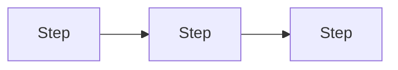
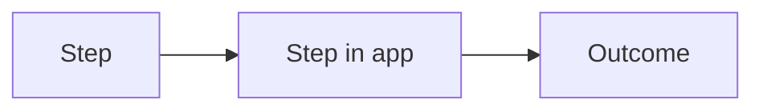
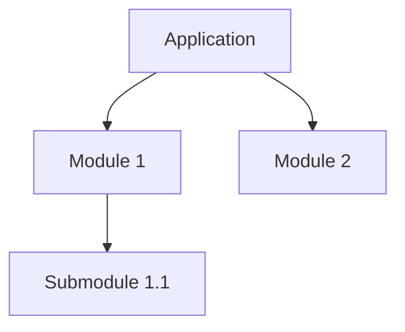

# [Project Name] — ADB 01: Business Requirements Document (BRD)

> **Application Design Book (ADB) — Book 1 of 5.** Business view only: why, who, what, and what not. No technology here.
> Guideline: `guidelines/01-BRD.guide.md`. Replace every `[placeholder]`. Use `N/A — reason` for sections that don't apply and `TBD — see Q-xx` for unresolved items.

---

## 0. Document Info

| Field | Value |
|---|---|
| Project name | [Name] |
| Project code | [Short code, e.g. NXW] |
| Book | ADB 01 — BRD |
| Version | [0.1.0] |
| Status | [Draft / In Review / Approved / Deprecated] |
| Author(s) | [Name, role] |
| Reviewer(s) | [Name, role] |
| Approver(s) | [Name, role] |
| Created | [YYYY-MM-DD] |
| Last updated | [YYYY-MM-DD] |
| Related books | [Links to ADB 02–05] |

### Change Log

| Version | Date | Author | Summary of changes |
|---|---|---|---|
| 0.1.0 | [YYYY-MM-DD] | [Name] | Initial draft |

---

## 1. Overview

### 1.1 Background
[The current situation and how work is done today.]

### 1.2 Problem Statement
[The specific problems this application solves. Who suffers and how.]

### 1.3 Purpose
[1–3 sentences: why this application exists.]

### 1.4 Objectives & Success Metrics

| ID | Objective | Success metric | Baseline (today) | Target | By when |
|---|---|---|---|---|---|
| OBJ-01 | [Objective] | [How it's measured] | [Current value] | [Target value] | [YYYY-MM-DD] |

### 1.5 Description
[2–5 sentence summary of the application: what it is, who uses it, main capabilities, platform.]

---

## 2. Stakeholders & Users

### 2.1 Stakeholders

| Stakeholder | Role in project | Interest / concern | Decision power | Contact |
|---|---|---|---|---|
| [Name / group] | [Sponsor / owner / user / operator] | [What they care about] | [Approve / consult / inform] | [Email] |

### 2.2 User Personas

| Persona ID | Persona | Description | Goals | Pain points | Device & context |
|---|---|---|---|---|---|
| PER-01 | [Name — role] | [Background, tech skill] | [What they want] | [What frustrates them] | [Phone at shop counter / desktop in office] |

### 2.3 User Roles (business view)

| Role ID | Role | Who holds it | What they are responsible for | Est. number of users |
|---|---|---|---|---|
| ROLE-01 | [Admin] | [Job title] | [Responsibilities] | [e.g. 5] |

---

## 3. Main Application

### 3.1 Application Concept
[How the application works end to end, in plain language. What the user sees first, the main loop of work, and the outcome.]

### 3.2 Application Scopes (areas)

| Scope | Purpose | Who uses it | Example |
|---|---|---|---|
| [admin] | [Back-office management] | [ROLE-01] | [Manage master data] |
| [me] | [Personal workspace] | [All users] | [My tasks] |

### 3.3 Business Process — Current (As-Is)

[Pain points in the current process.]

### 3.4 Business Process — Future (To-Be)

[What changes and what improves.]

### 3.5 Usage & Volume Expectations (business terms)

| Question | Answer |
|---|---|
| Users at launch | [Number] |
| Users after 1 year | [Number] |
| Users active at the busiest moment | [Number or %] |
| Busiest times / peaks | [e.g. Month-end close, 9–10 am] |
| Key records created per day | [e.g. 500 orders / day] |
| How far back users need history | [e.g. 5 years] |
| Impact if the app is down for 1 hour at peak | [Business consequence] |
| Acceptable data loss | [e.g. none / last hour / last day] |
| Where users are located | [Countries / sites] |

---

## 4. Modules & Work

### 4.1 Module Map

| Module code | Module | Purpose | Scope(s) | Primary roles | Priority |
|---|---|---|---|---|---|
| [PRJ] | [Project] | [What it manages] | [admin, me] | [ROLE-01] | [Must / Should / Could] |

### 4.2 Module Detail

> Repeat this block for every module. Submodules get their own block under the parent.

#### MOD-[CODE]: [Module name]

| Field | Value |
|---|---|
| Module code | [PRJ] |
| Parent module | [— or parent code] |
| Purpose | [What business need it serves] |
| Users / roles | [ROLE-xx] |
| Main business objects | [e.g. Project, Member, Budget] |
| Submodules | [List of codes, or —] |

**Work (features) in this module**

| Feature ID | Feature | Description | Actor | Priority | Acceptance criteria |
|---|---|---|---|---|---|
| F-[CODE]-01 | [Create project] | [What the user can do] | [ROLE-xx] | [Must / Should / Could / Won't] | [Given / when / then] |

**Business rules for this module**

| Rule ID | Rule | Applies to |
|---|---|---|
| BR-[CODE]-01 | [e.g. A project cannot be closed while it has open issues] | F-[CODE]-xx |

**Statuses / lifecycle (business view)**

| Status | Meaning | Who can move it here | Next possible statuses |
|---|---|---|---|
| [Draft] | [Meaning] | [ROLE-xx] | [Active, Cancelled] |

**Notifications & reports**

| Item | Type | Trigger / schedule | Recipient |
|---|---|---|---|
| [Overdue alert] | [Notification / report / export] | [When] | [ROLE-xx] |

### 4.3 Cross-Module Rules

| Rule ID | Rule | Modules involved |
|---|---|---|
| BR-X-01 | [e.g. Deleting a project archives its milestones and tasks] | [PRJ, MLS] |

### 4.4 Permissions (business view)

| Feature ID | [ROLE-01] | [ROLE-02] | [ROLE-03] |
|---|---|---|---|
| F-[CODE]-01 | ✅ | Own only | ❌ |

---

## 5. Scope

### 5.1 In Scope (this release)

| # | Item | Related modules / features |
|---|---|---|
| IS-01 | [Capability] | [MOD / F-IDs] |

### 5.2 Out of Scope

| # | Item | Reason | Planned phase |
|---|---|---|---|
| OS-01 | [Capability] | [Why not now] | [Phase 2 / never] |

### 5.3 Release Phases

| Phase | Goal | Included modules / features | Target date |
|---|---|---|---|
| [MVP] | [Goal] | [MOD / F-IDs] | [YYYY-MM-DD] |

---

## 6. Limitations, Assumptions & Constraints

### 6.1 Known Limitations

| ID | Limitation | Business impact | Workaround |
|---|---|---|---|
| LIM-01 | [e.g. No offline mode in v1] | [Impact] | [Workaround] |

### 6.2 Assumptions

| ID | Assumption | Impact if wrong | Owner to validate |
|---|---|---|---|
| A-01 | [Believed true but unverified] | [Impact] | [Name] |

### 6.3 Constraints

| ID | Type | Constraint |
|---|---|---|
| C-01 | [Budget / Time / Legal / Organization / Technology] | [Constraint] |

### 6.4 Dependencies

| ID | Dependency | Type | Owner | Status |
|---|---|---|---|---|
| D-01 | [e.g. Payment provider account approval] | [External / internal] | [Name] | [Pending / Done] |

---

## 7. Compliance & Policy

| Regulation / policy | Applies because | Business requirement |
|---|---|---|
| [PDPA] | [We store customer personal data] | [Consent at signup; users can request deletion] |

---

## 8. Risks

| ID | Risk | Likelihood | Impact | Mitigation | Owner |
|---|---|---|---|---|---|
| R-01 | [Risk] | [Low / Med / High] | [Low / Med / High] | [Plan] | [Name] |

---

## 9. Glossary

| Term | Definition |
|---|---|
| [Term] | [Meaning in this project] |

---

## 10. Open Questions

| ID | Question | Raised by | Owner | Due | Answer |
|---|---|---|---|---|---|
| Q-01 | [Question] | [Name] | [Name] | [YYYY-MM-DD] | [Pending] |

---

## 11. Sign-off

| Name | Role | Decision | Date |
|---|---|---|---|
| [Name] | [Role] | [Approved / Approved with changes / Rejected] | [YYYY-MM-DD] |
