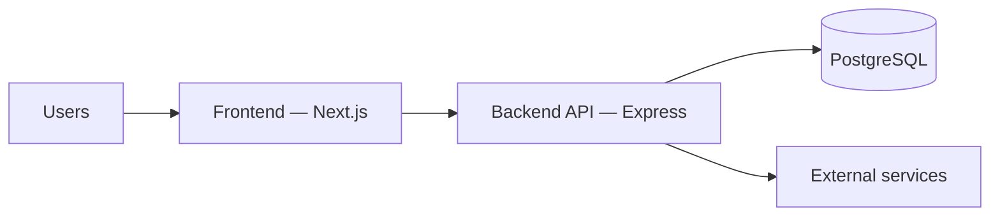
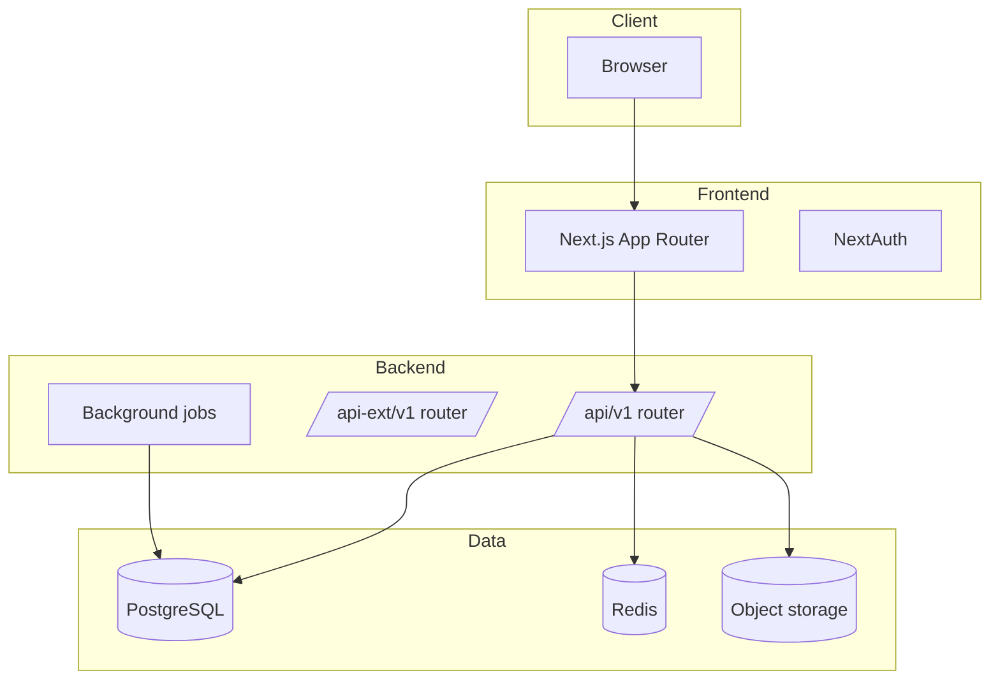
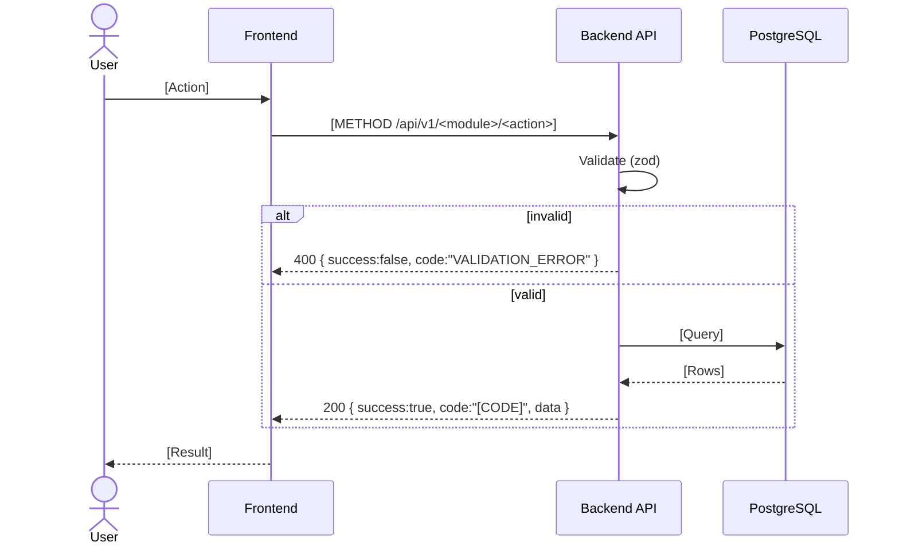
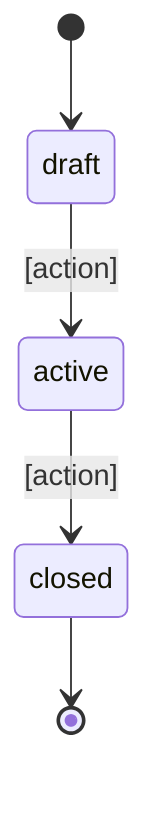
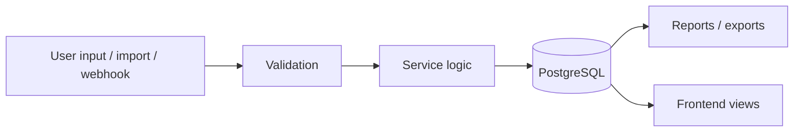
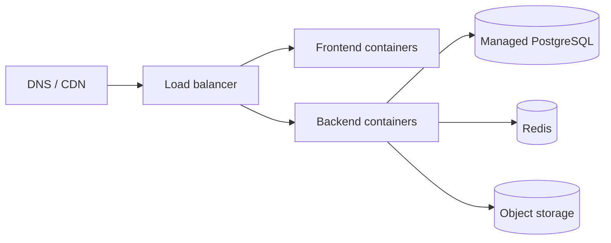
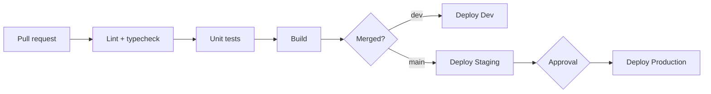

# [Project Name] — ADB 02: Software Requirements Specification (SRS)

> **Application Design Book (ADB) — Book 2 of 5.** The technical view of the whole system: quality targets, architecture, workflows, data flow, security, infrastructure, pipeline, and disaster recovery. Endpoint-level detail lives in ADB 04, tables in ADB 03, and screens in ADB 05.
> Guideline: `guidelines/02-SRS.guide.md`. Replace every `[placeholder]`. Use `N/A — reason` and `TBD — see Q-xx`.

---

## 0. Document Info

| Field | Value |
|---|---|
| Project name | [Name] |
| Project code | [Code] |
| Book | ADB 02 — SRS |
| Version | [0.1.0] |
| Status | [Draft / In Review / Approved / Deprecated] |
| Author(s) | [Name, role] |
| Reviewer(s) | [Name, role] |
| Approver(s) | [Name, role] |
| Created | [YYYY-MM-DD] |
| Last updated | [YYYY-MM-DD] |
| Based on BRD version | [ADB 01 vX.Y.Z] |

### Change Log

| Version | Date | Author | Summary of changes |
|---|---|---|---|
| 0.1.0 | [YYYY-MM-DD] | [Name] | Initial draft |

---

## 1. Non-Functional Requirements (NFR)

| ID | Category | Requirement | Measurable target | Derived from (BRD) |
|---|---|---|---|---|
| NFR-01 | Performance | [Description] | [p95 API latency < 300 ms] | [BRD 3.5 — users at peak] |
| NFR-02 | Availability | [Description] | [99.9% monthly] | [BRD 3.5 — impact of downtime] |
| NFR-03 | Scalability | [Description] | [N concurrent users] | |
| NFR-04 | Security | [Description] | [Target] | |
| NFR-05 | Usability / Accessibility | [Description] | [WCAG 2.2 AA] | |
| NFR-06 | Maintainability | [Description] | [Coverage ≥ 80% on services] | |
| NFR-07 | Compatibility | [Description] | [Browsers / OS / devices] | |
| NFR-08 | Data retention | [Description] | [Duration] | |
| NFR-09 | Localization | [Description] | [Languages, timezone, currency] | |

### 1.1 Capacity Estimate

| Input (from BRD) | Value |
|---|---|
| Total users (launch / 1 year) | [N / N] |
| Peak concurrent users | [N] |
| Actions per active user per minute | [N] |
| **Estimated peak requests / second** | [N] |
| **Design target (with headroom)** | [N] |
| Data growth per year | [N GB] |
| File storage growth per year | [N GB] |

---

## 2. Architecture

### 2.1 Architecture Style
[Modular monolith / microservices / serverless, and why.]

### 2.2 System Context Diagram

### 2.3 Container / Component Diagram

### 2.4 System Components

| Component | Responsibility | Technology | Communicates with | Owner |
|---|---|---|---|---|
| [Frontend] | [UI, routing, session] | [Next.js] | [Backend API] | [Team] |

### 2.5 Tech Stack

| Layer | Technology | Version | Reason for choice | Alternatives considered |
|---|---|---|---|---|
| Frontend framework | Next.js (App Router) | [x.y] | [Reason] | [Options] |
| UI kit | shadcn/ui + Tailwind CSS | [x.y] | | |
| Frontend lint | ESLint | [x.y] | | |
| Backend runtime | Node.js | [x.y] | | |
| Backend framework | Express.js + TypeScript | [x.y] | | |
| Validation | Zod | [x.y] | | |
| Database | PostgreSQL | [x.y] | | |
| Query / migration tool | [Knex / Drizzle / Prisma] | [x.y] | | |
| Cache / queue | [Redis / BullMQ] | [x.y] | | |
| Auth | [NextAuth + JWT] | [x.y] | | |
| File storage | [S3 / MinIO] | | | |
| API docs | [OpenAPI / Swagger] | | | |
| Hosting | [Provider] | | | |
| CI/CD | [GitHub Actions] | | | |
| Monitoring | [Tool] | | | |

---

## 3. Workflows

### 3.1 Workflow Catalog

| Workflow ID | Workflow | Modules | Trigger | Related features (BRD) |
|---|---|---|---|---|
| WF-01 | [Login] | [AUTH] | [User submits credentials] | [F-AUTH-01] |

### 3.2 Sequence Diagrams

> One block per workflow in 3.1. Include error and timeout paths.

#### WF-01: [Workflow name]

| Step | Notes / rules applied |
|---|---|
| [n] | [BR-xx, timeout, retry] |

### 3.3 State Diagrams

> One per entity that has a status. States must match the enums in ADB 03.

#### [Entity] lifecycle

| From | To | Action / endpoint | Who | Guard (rule) |
|---|---|---|---|---|
| [draft] | [active] | [PUT /api/v1/<module>/:<module>Id/edit] | [ROLE-xx] | [BR-xx] |

### 3.4 Background Jobs & Scheduled Tasks

| Job ID | Job | Schedule / trigger | What it does | Retry policy | Failure alert |
|---|---|---|---|---|---|
| JOB-01 | [Name] | [cron / event] | [Description] | [3x exponential] | [Channel] |

---

## 4. Data Flow

### 4.1 Data Flow Diagram

### 4.2 Data Flow Catalog

| Flow ID | Source | Data | Destination | Transform | Contains PII? | Frequency |
|---|---|---|---|---|---|---|
| DF-01 | [Source] | [Data] | [Destination] | [Transform] | [Yes / No] | [Real-time / daily] |

---

## 5. Integrations

| ID | Service | Purpose | Type | Direction | Auth method | Rate limit | Failure fallback | Docs |
|---|---|---|---|---|---|---|---|---|
| INT-01 | [Service] | [Why] | [REST / SDK / webhook] | [Outbound / inbound] | [API key / OAuth] | [Limit] | [Fallback] | [URL] |

---

## 6. Security

### 6.1 Authentication

| Item | Value |
|---|---|
| Login methods | [Email + password / SSO / OAuth provider] |
| Session strategy | [NextAuth session + backend JWT] |
| Access token lifetime | [15 min] |
| Refresh strategy | [Refresh token, httpOnly cookie, N days] |
| MFA | [Required for roles…] |
| Password policy | [Rules] |
| Logout / revoke | [Behavior] |

### 6.2 Authorization
[How permissions are enforced: middleware per route, role check, ownership check.]

| Role ID | Role | Enforced by |
|---|---|---|
| ROLE-01 | [Admin] | [auth.middleware + permission map] |

### 6.3 Security Measures

| Area | Measure |
|---|---|
| Data in transit | [TLS 1.2+] |
| Data at rest | [Encryption] |
| Secrets | [Secret manager, never in Git] |
| Input validation | [Zod on every endpoint] |
| Rate limiting | [Limits] |
| CORS | [Allowed origins] |
| Security headers | [helmet, CSP] |
| Audit log | [What is logged] |
| Dependency scanning | [Tool] |
| File upload | [Type / size limits, virus scan] |

### 6.4 Compliance Implementation

| Regulation (BRD 7) | Technical measure |
|---|---|
| [PDPA] | [Consent stored in `user_consents`; delete endpoint anonymizes PII] |

---

## 7. Infrastructure

### 7.1 Deployment Diagram

### 7.2 Infrastructure Inventory

| Item | Choice | Size / tier | Region | Notes |
|---|---|---|---|---|
| Hosting / cloud | [Provider] | | [Region] | |
| Frontend compute | [Service] | | | |
| Backend compute | [Service] | [vCPU / RAM × N] | | |
| Database | [Managed PostgreSQL] | | | |
| Cache / queue | [Redis] | | | |
| Object storage | [Service] | | | |
| CDN | [Service] | | | |
| DNS / domain | [Provider] | | | |
| Estimated monthly cost | [Amount] | | | |

### 7.3 Environments

| Environment | Frontend URL | Backend URL | Purpose | Data | Deploy trigger |
|---|---|---|---|---|---|
| Local | localhost:3000 | localhost:[port] | Development | Seeds | Manual |
| Dev | [URL] | [URL] | Integration | Fake data | [Merge to `dev`] |
| Staging (UAT) | [URL] | [URL] | Pre-release / UAT | [Anonymized] | [Merge to `main`] |
| Production | [URL] | [URL] | Live | Real | [Tag + approval] |

---

## 8. CI/CD Pipeline

### 8.1 Branch Strategy
[Trunk-based / GitFlow; branch naming; PR rules.]

### 8.2 Pipeline Stages

| Stage | Tool | Runs on | Fails build if |
|---|---|---|---|
| Lint & typecheck | [ESLint, tsc] | [Every PR] | [Any error] |
| Unit tests | [Tool] | | [Coverage < target] |
| Integration tests | [Tool] | | |
| Build | [Docker] | | |
| DB migration | [Tool] | [Before deploy] | [Migration error] |
| Deploy | [Tool] | | |
| Smoke test | [Tool] | [After deploy] | [Health check fails] |

### 8.3 Release & Rollback
[Versioning, release notes, rollback steps, migration rollback rule.]

---

## 9. Observability

| Item | Tool | What's tracked | Alert condition | Notified |
|---|---|---|---|---|
| Application logs | [Tool] | [Structured JSON, requestId] | | |
| Metrics | [Tool] | [Latency, error rate, CPU] | [Threshold] | [Channel] |
| Error tracking | [Tool] | [Exceptions FE + BE] | [New error] | |
| Uptime | [Tool] | [/health] | [Down > 1 min] | |
| Job monitoring | [Tool] | [Failed jobs] | [Any failure] | |

---

## 10. Backup & Disaster Recovery

### 10.1 Targets

| Item | Value | Derived from (BRD 3.5) |
|---|---|---|
| RPO (max data loss) | [1 hour] | [Acceptable data loss] |
| RTO (max downtime) | [4 hours] | [Impact of downtime] |

### 10.2 Backup Plan

| Asset | Method | Frequency | Retention | Storage location | Encrypted |
|---|---|---|---|---|---|
| PostgreSQL | [Snapshot + PITR] | [Daily + continuous] | [30 days] | [Other region] | [Yes] |
| Object storage | [Versioning / replication] | | | | |
| Secrets / config | [Method] | | | | |

### 10.3 Disaster Scenarios

| Scenario | Detection | Recovery steps | Owner | Expected recovery time |
|---|---|---|---|---|
| [DB corruption / accidental delete] | [Alert] | [Restore PITR to time T] | [Name] | [Time] |
| [Region outage] | | | | |
| [Bad deployment] | | [Rollback to previous image] | | |
| [Leaked secret] | | [Rotate keys, revoke sessions] | | |

### 10.4 DR Testing

| Test | Frequency | Last run | Result |
|---|---|---|---|
| Restore backup to staging | [Quarterly] | [YYYY-MM-DD] | [Pass / Fail] |

---

## 11. Testing Strategy

| Test type | Tool | Scope | Coverage target | When it runs |
|---|---|---|---|---|
| Unit (BE) | [Tool] | [`*.service.ts`] | [80%] | Every PR |
| Integration (BE) | [Tool] | [Routes + DB] | | Every PR |
| Manual API | Bruno | [`bruno-API/`] | | Before release |
| Unit / component (FE) | [Tool] | [Feature hooks, utils] | | Every PR |
| E2E | [Tool] | [Critical flows] | | Before release |
| Performance | [Tool] | [NFR-01, NFR-03] | | [Schedule] |
| Security | [Tool] | [Dependencies, OWASP] | | |

---

## 12. Traceability Matrix

| Feature (BRD) | Workflow | Endpoint(s) (ADB 04) | Table(s) (ADB 03) | Screen(s) (ADB 05) | Test |
|---|---|---|---|---|---|
| F-[CODE]-01 | WF-xx | [POST /api/v1/<module>/create] | [table] | [SC-xx] | [Test ID] |

---

## 13. Architecture Decision Records (ADR)

### ADR-001: [Decision title]

| Field | Value |
|---|---|
| Date | [YYYY-MM-DD] |
| Status | [Proposed / Accepted / Superseded by ADR-xxx] |
| Context | [Situation and forces] |
| Decision | [What was decided] |
| Alternatives | [Options considered] |
| Consequences | [Trade-offs] |

---

## 14. Open Questions

| ID | Question | Raised by | Owner | Due | Answer |
|---|---|---|---|---|---|
| Q-01 | [Question] | [Name] | [Name] | [YYYY-MM-DD] | [Pending] |
