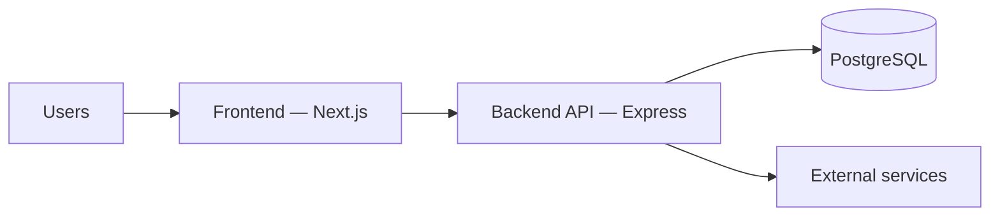
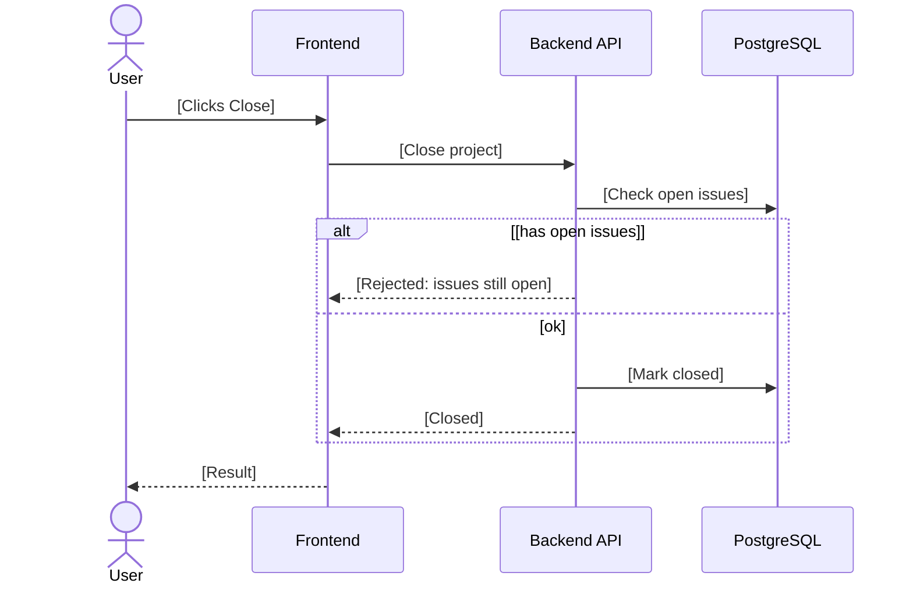
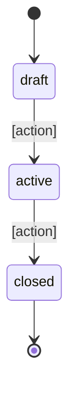
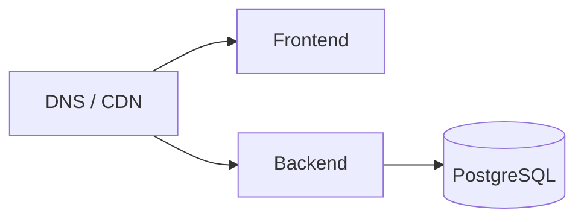

# [Project Name] — ADB 02: Software Requirements Specification (SRS)

> **Application Design Book (ADB) — Book 2 of 5.** The technical view of the whole system: quality targets, architecture, workflows, security, infrastructure, and recovery. Tables live in ADB 03, endpoints in ADB 04, screens in ADB 05.
> Guideline: `guidelines/02-SRS.guide.md`. Section tags: **Core** = always fill · **Optional** = fill only if it applies, otherwise one line `N/A — reason` · **Standard** = follows `CONVENTIONS.md`, list only differences (each needs an ADR in §13). Untagged subsections follow their parent's tag.
> Keep it short: tables and bullets. Use `TBD — see Q-NN` for unresolved items.

---

## 0. Document Info

> **Core**

| Field                | Value                                       |
| -------------------- | ------------------------------------------- |
| Project name         | [Name]                                      |
| Project code         | [Code]                                      |
| Book                 | ADB 02 — SRS                                |
| Version              | [0.1.0]                                     |
| Status               | [Draft / In Review / Approved / Deprecated] |
| Author(s)            | [Name, role]                                |
| Last updated         | [YYYY-MM-DD]                                |
| Based on BRD version | [ADB 01 vX.Y.Z]                             |

### Change Log

| Version | Date         | Author | Summary of changes |
| ------- | ------------ | ------ | ------------------ |
| 0.1.0   | [YYYY-MM-DD] | [Name] | Initial draft      |

---

## 1. Non-Functional Requirements (NFR)

> **Core.** List only the categories that matter for this project.

| ID     | Category       | Measurable target                  | Derived from (BRD)             |
| ------ | -------------- | ---------------------------------- | ------------------------------ |
| NFR-01 | [Performance]  | [p95 API latency < 300 ms at peak] | [BRD 3.4 — users at peak]      |
| NFR-02 | [Availability] | [99.5% monthly]                    | [BRD 3.4 — impact of downtime] |

### 1.1 Capacity Estimate

| Input (from BRD 3.4)                              | Value                     |
| ------------------------------------------------- | ------------------------- |
| Peak concurrent users                             | [N]                       |
| Actions per user per minute × requests per action | [N × N]                   |
| **Estimated peak requests / second**              | [N] (show the arithmetic) |
| **Design target (with headroom)**                 | [N]                       |
| Data growth per year                              | [N GB]                    |

---

## 2. Architecture

> **Core**

### 2.1 Architecture Style

[Default: modular monolith (one Express app, one folder per module). Anything else needs a reason and an ADR.]

### 2.2 System Context Diagram

### 2.3 Components

> **Optional:** when there is more than frontend, backend, and database (cache, queue, storage, jobs).

| Component         | Responsibility    | Technology | Talks to            |
| ----------------- | ----------------- | ---------- | ------------------- |
| [Background jobs] | [Scheduled tasks] | [BullMQ]   | [PostgreSQL, Redis] |

### 2.4 Tech Stack

> Fixed stack: `CONVENTIONS.md` §1. Fill only the open choices.

| Layer                  | Technology                | Version | Reason   |
| ---------------------- | ------------------------- | ------- | -------- |
| Query / migration tool | [Knex / Drizzle / Prisma] | [x.y]   | [Reason] |
| Cache / queue          | [Redis / BullMQ / none]   |         |          |
| File storage           | [S3 / MinIO / none]       |         |          |
| Hosting                | [Provider]                |         |          |
| CI/CD                  | [GitHub Actions]          |         |          |
| Monitoring             | [Tool]                    |         |          |

---

## 3. Workflows

> **Core**

### 3.1 Workflow Catalog

> Only the main or hard flows that aren't obvious from the backend spec (usually 2–5): multi-step processes, approvals, money, outside services. Plain create/search/get/edit/delete and simple rules need no workflow.

| Workflow ID | Workflow        | Why it needs a diagram                  | Trigger           | Features (BRD) |
| ----------- | --------------- | --------------------------------------- | ----------------- | -------------- |
| WF-01       | [Close project] | [Checks open issues, notifies the team] | [PM clicks Close] | [F-PRJ-03]     |

### 3.2 Sequence Diagrams

> One per workflow in 3.1. Describe the steps in plain words; exact endpoints, modules and codes are mapped during implementation. Show the main failure path.

#### WF-01: [Workflow name]

### 3.3 State Diagrams

> **Optional:** one per item that has statuses (BRD §4.2). States use the enum values in ADB 03 §3.

#### [Entity] lifecycle

| From    | To       | Action     | Guard (rule) |
| ------- | -------- | ---------- | ------------ |
| [draft] | [active] | [Activate] | [BR-xx]      |

### 3.4 Background Jobs & Scheduled Tasks

> **Optional**

| Job ID | Job    | Schedule / trigger | What it does  | On failure                |
| ------ | ------ | ------------------ | ------------- | ------------------------- |
| JOB-01 | [Name] | [cron / event]     | [Description] | [Retry 3×, alert channel] |

---

## 4. Data Flow

> **Optional:** when data comes from imports, other systems, or feeds reports and exports.

| Flow ID | Source   | Data   | Destination   | Contains PII? | Frequency           |
| ------- | -------- | ------ | ------------- | ------------- | ------------------- |
| DF-01   | [Source] | [Data] | [Destination] | [Yes / No]    | [Real-time / daily] |

---

## 5. Integrations

> **Optional:** when the app talks to any outside service.

| ID     | Service              | Purpose | Direction            | Auth              | If it is down                 |
| ------ | -------------------- | ------- | -------------------- | ----------------- | ----------------------------- |
| INT-01 | [LINE Messaging API] | [Why]   | [Outbound / inbound] | [Token / API key] | [Queue and retry, then email] |

---

## 6. Security

> **Core**

### 6.1 Authentication

| Item                     | Value                                                   |
| ------------------------ | ------------------------------------------------------- |
| Login methods            | [Email + password / SSO / OAuth provider]               |
| Session & token lifetime | [NextAuth session; access token 15 min; refresh N days] |
| MFA                      | [Required for roles… / none]                            |

### 6.2 Authorization & Security Measures

> **Standard:** `CONVENTIONS.md` §6.1–6.2. Permissions are in BRD §4.4; ownership rules in ADB 04 §6.3.

| Difference from the standard | Reason | ADR |
| ---------------------------- | ------ | --- |
| [None]                       |        |     |

### 6.3 Compliance Implementation

> **Optional:** one row per BRD §7 item.

| Regulation (BRD 7) | Technical measure                                                   |
| ------------------ | ------------------------------------------------------------------- |
| [PDPA]             | [Consent stored in `user_consents`; delete endpoint anonymizes PII] |

---

## 7. Infrastructure

> **Core**

### 7.1 Infrastructure Inventory

| Item                        | Choice               | Size / tier      | Region   |
| --------------------------- | -------------------- | ---------------- | -------- |
| Frontend hosting            | [Service]            |                  | [Region] |
| Backend hosting             | [Service]            | [vCPU / RAM × N] |          |
| Database                    | [Managed PostgreSQL] |                  |          |
| Other (cache, storage, CDN) | [Service / none]     |                  |          |
| Estimated monthly cost      | [Amount]             |                  |          |

### 7.2 Environments

| Environment   | Frontend URL | Backend URL | Data         |
| ------------- | ------------ | ----------- | ------------ |
| Dev           | [URL]        | [URL]       | Fake data    |
| Staging (UAT) | [URL]        | [URL]       | [Anonymized] |
| Production    | [URL]        | [URL]       | Real         |

### 7.3 Deployment Diagram

> **Optional:** when the setup is more than one frontend, one backend, and one database.

---

## 8. CI/CD Pipeline

> **Standard:** `CONVENTIONS.md` §6.3.

| Difference from the standard | Reason | ADR |
| ---------------------------- | ------ | --- |
| [None]                       |        |     |

---

## 9. Observability

> **Standard:** `CONVENTIONS.md` §6.4. Fill only who gets alerts.

| Alert channel | Owner  |
| ------------- | ------ |
| [#app-alerts] | [Name] |

---

## 10. Backup & Disaster Recovery

> **Core**

### 10.1 Targets

| Item                | Value     | Derived from (BRD 3.4) |
| ------------------- | --------- | ---------------------- |
| RPO (max data loss) | [1 hour]  | [Acceptable data loss] |
| RTO (max downtime)  | [4 hours] | [Impact of downtime]   |

### 10.2 Backup Plan & Scenarios

> **Standard:** `CONVENTIONS.md` §6.5. List only what differs because of the targets above.

| Difference from the standard | Reason | ADR |
| ---------------------------- | ------ | --- |
| [None]                       |        |     |

---

## 11. Testing Strategy

> **Standard:** `CONVENTIONS.md` §6.6. List the critical flows for E2E tests.

| Critical flow   | Workflow / feature |
| --------------- | ------------------ |
| [Close project] | [WF-01]            |

---

## 12. Traceability Matrix

> **Optional:** for large projects or audits. Otherwise the links in ADB 04 §7 (feature per endpoint) and ADB 05 §5.1 (feature per screen) are enough.

| Feature (BRD) | Endpoint(s) (ADB 04)           | Table(s) (ADB 03) | Screen(s) (ADB 05) |
| ------------- | ------------------------------ | ----------------- | ------------------ |
| F-[CODE]-01   | [POST /api/v1/<module>/create] | [table]           | [SC-xx]            |

---

## 13. Architecture Decision Records (ADR)

> **Optional:** one per decision that differs from `CONVENTIONS.md` or isn't obvious.

### ADR-001: [Decision title]

| Field         | Value                                                        |
| ------------- | ------------------------------------------------------------ |
| Date / status | [YYYY-MM-DD] · [Proposed / Accepted / Superseded by ADR-xxx] |
| Context       | [Situation and forces]                                       |
| Decision      | [What was decided]                                           |
| Alternatives  | [Options considered]                                         |
| Consequences  | [Trade-offs]                                                 |

---

## 14. Open Questions

> **Core**

| ID   | Question   | Owner  | Due          | Answer    |
| ---- | ---------- | ------ | ------------ | --------- |
| Q-01 | [Question] | [Name] | [YYYY-MM-DD] | [Pending] |
