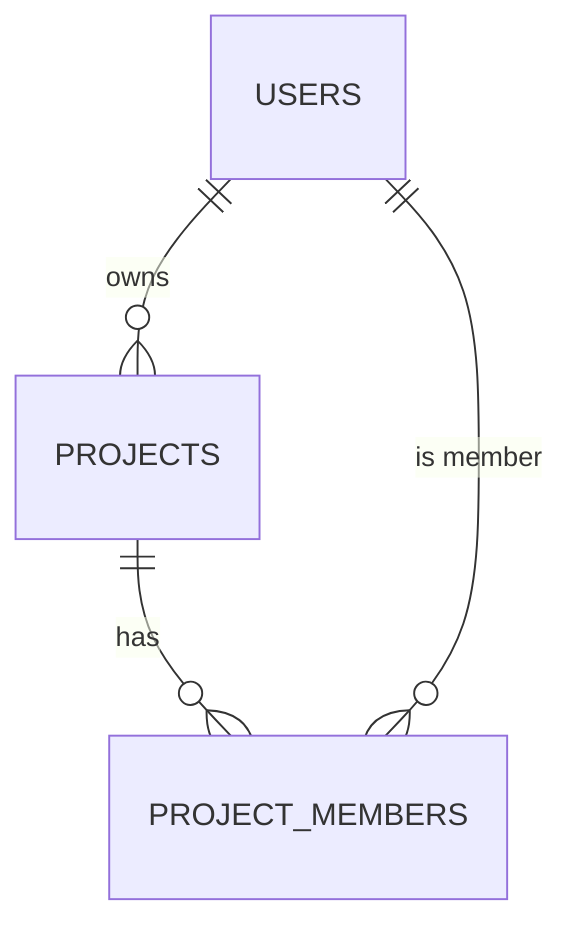

# [Project Name] — ADB 03: Database Schema

> **Application Design Book (ADB) — Book 3 of 5.** PostgreSQL schema, grouped by module: ERD, SQL DDL, table dictionary, indexes, and the TypeScript data model for every table.
> Guideline: `guidelines/03-DB-SCHEMA.guide.md`. Replace every `[placeholder]`. Use `N/A — reason` and `TBD — see Q-xx`.

---

## 0. Document Info

| Field | Value |
|---|---|
| Project name | [Name] |
| Project code | [Code] |
| Book | ADB 03 — DB Schema |
| Version | [0.1.0] |
| DB schema version | [v-1-0-0] |
| Status | [Draft / In Review / Approved / Deprecated] |
| Author(s) | [Name, role] |
| Reviewer(s) | [Name, role] |
| Created | [YYYY-MM-DD] |
| Last updated | [YYYY-MM-DD] |
| Database | PostgreSQL [version] |

### Change Log

| Version | DB schema version | Date | Author | Summary of changes | Migration file |
|---|---|---|---|---|---|
| 0.1.0 | v-1-0-0 | [YYYY-MM-DD] | [Name] | Initial schema | `migrations/v-1-0-0_init.ts` |

---

## 1. Conventions

| Item | Rule |
|---|---|
| Schema(s) | [public / per-module schemas] |
| Table names | snake_case, plural (`projects`, `project_members`) |
| Column names | snake_case (`created_at`) |
| Primary key | `id uuid DEFAULT gen_random_uuid()` |
| Foreign key | `<singular_table>_id` (`project_id`) |
| Timestamps | `timestamptz`, stored in UTC |
| Money | `numeric(14,2)`; never float |
| Booleans | `is_` / `has_` prefix |
| Enums | [PostgreSQL ENUM type / CHECK constraint / lookup table] |
| JSONB | Only for flexible, non-queried structures; shape documented in §5 |
| Soft delete | [`deleted_at timestamptz NULL` on all business tables / none] |
| Audit columns | `created_at`, `created_by`, `updated_at`, `updated_by` |
| Index names | `idx_<table>_<columns>`; unique: `uq_<table>_<columns>` |
| FK names | `fk_<table>_<ref_table>` |
| Migration files | `migrations/v-<x>-<y>-<z>_<topic>.ts` |
| Seed files | `seeds/v-<x>-<y>-<z>_<topic>.ts` |

### 1.1 Standard Columns

```sql
-- Included on every business table
id          uuid        PRIMARY KEY DEFAULT gen_random_uuid(),
created_at  timestamptz NOT NULL DEFAULT now(),
created_by  uuid        NULL REFERENCES users(id),
updated_at  timestamptz NOT NULL DEFAULT now(),
updated_by  uuid        NULL REFERENCES users(id),
deleted_at  timestamptz NULL
```

---

## 2. Module Overview

| Module code | Module | Tables | Owner |
|---|---|---|---|
| [CORE] | [Core / shared] | [users, roles, …] | [Name] |
| [PRJ] | [Project] | [projects, project_members] | [Name] |

### 2.1 Full ERD



---

## 3. Enumerations

| Enum type | Values | Used by | Description | Matches state diagram (ADB 02) |
|---|---|---|---|---|
| [project_status] | [draft, active, closed, cancelled] | [projects.status] | [Meaning] | [§3.3 Project lifecycle] |

```sql
CREATE TYPE [project_status] AS ENUM ('[draft]', '[active]', '[closed]', '[cancelled]');
```

---

## 4. Modules

> Repeat §4.x for every module. Inside each module, repeat the table block for every table.

### 4.1 Module [CODE] — [Module name]

[What this module stores.]

#### 4.1.1 Module ERD

```mermaid
erDiagram
    [TABLE_A] ||--o{ [TABLE_B] : "[relationship]"
```

#### 4.1.2 Table: `[table_name]`

[What one row represents.]

**SQL**

```sql
CREATE TABLE [table_name] (
  id          uuid          PRIMARY KEY DEFAULT gen_random_uuid(),
  [column]    [type]        [NOT NULL] [DEFAULT …],
  [fk_id]     uuid          NOT NULL,
  status      [enum_type]   NOT NULL DEFAULT '[value]',
  created_at  timestamptz   NOT NULL DEFAULT now(),
  created_by  uuid          NULL,
  updated_at  timestamptz   NOT NULL DEFAULT now(),
  updated_by  uuid          NULL,
  deleted_at  timestamptz   NULL,

  CONSTRAINT fk_[table]_[ref] FOREIGN KEY ([fk_id]) REFERENCES [ref_table](id) ON DELETE [RESTRICT / CASCADE / SET NULL],
  CONSTRAINT uq_[table]_[cols] UNIQUE ([cols]),
  CONSTRAINT ck_[table]_[rule] CHECK ([condition])
);

CREATE INDEX idx_[table]_[cols] ON [table_name] ([cols]) WHERE deleted_at IS NULL;

COMMENT ON TABLE [table_name] IS '[Description]';
COMMENT ON COLUMN [table_name].[column] IS '[Description]';
```

**Columns**

| Column | Type | Nullable | Default | Key / constraint | Description | Example |
|---|---|---|---|---|---|---|
| id | uuid | No | gen_random_uuid() | PK | Unique identifier | `3f2a…` |
| [column] | [type] | [Yes / No] | [value] | [FK / UQ / CK] | [Business meaning] | [Example] |
| created_at | timestamptz | No | now() | | Created time (UTC) | |
| created_by | uuid | Yes | | FK users | Creator | |
| updated_at | timestamptz | No | now() | | Last update (UTC) | |
| updated_by | uuid | Yes | | FK users | Last editor | |
| deleted_at | timestamptz | Yes | | | Soft-delete time | |

**Indexes**

| Index | Columns | Type | Partial condition | Supports query |
|---|---|---|---|---|
| idx_[table]_[cols] | [cols] | [B-tree / GIN / unique] | [deleted_at IS NULL] | [Endpoint / search filter] |

**Relationships**

| Relationship | Type | On delete | Notes |
|---|---|---|---|
| [table] → [ref_table] | [many-to-one] | [RESTRICT] | [Notes] |

**Business rules enforced in DB**

| Rule (BRD) | Enforcement |
|---|---|
| BR-[CODE]-xx | [CHECK / UNIQUE / trigger / service-only] |

**Data model (TypeScript)**

```ts
// src/types/db/[module].types.ts
export type [EntityName] = {
  id: string;
  [field]: [type];
  status: [EnumType];
  createdAt: string;
  createdBy: string | null;
  updatedAt: string;
  updatedBy: string | null;
  deletedAt: string | null;
};

export type [EnumType] = '[draft]' | '[active]' | '[closed]' | '[cancelled]';
```

**Endpoints that use this table (ADB 04)**

| Endpoint | Operation |
|---|---|
| [POST /api/v1/<module>/search] | [Read] |

---

## 5. JSONB Structures

| Table.column | Purpose | Queried by? |
|---|---|---|
| [table.settings] | [Purpose] | [No / GIN index] |

```ts
// src/types/db/jsonb.types.ts
export type [TableColumnJson] = {
  [key]: [type];
};
```

---

## 6. Views, Functions & Triggers

| Name | Type | Purpose | Used by |
|---|---|---|---|
| [trg_set_updated_at] | [Trigger] | [Keeps updated_at current] | [All tables] |

```sql
-- [Definition]
```

---

## 7. Data Retention & Privacy

| Table | Contains PII? | PII columns | Retention period | Deletion method |
|---|---|---|---|---|
| [users] | [Yes] | [email, phone] | [Duration] | [Soft delete then anonymize after N days] |

---

## 8. Seed Data

| Seed file | Tables | Environments | Purpose |
|---|---|---|---|
| `seeds/v-1-0-0_[topic].ts` | [roles] | [All / local+dev only] | [Master data / demo data] |

---

## 9. Migration Plan

| Migration file | DB version | Description | Reversible? | Data backfill |
|---|---|---|---|---|
| `migrations/v-1-0-0_init.ts` | v-1-0-0 | [Initial schema] | [Yes] | [None] |

### 9.1 Legacy Data Migration
[Source system, field mapping, cleanup rules, validation counts, rollback. Otherwise N/A — reason.]

| Legacy source | Legacy field | Target table.column | Transform |
|---|---|---|---|
| [System.table] | [field] | [table.column] | [Rule] |

---

## 10. Open Questions

| ID | Question | Raised by | Owner | Due | Answer |
|---|---|---|---|---|---|
| Q-01 | [Question] | [Name] | [Name] | [YYYY-MM-DD] | [Pending] |
