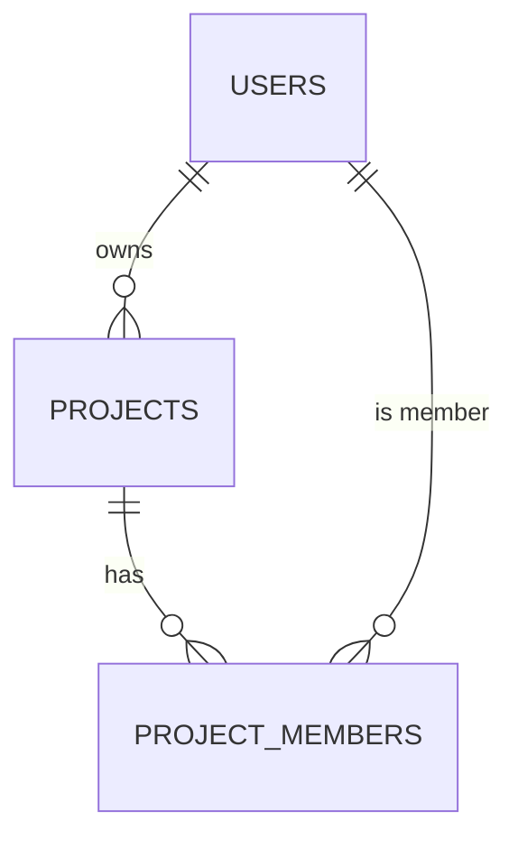

# [Project Name] — ADB 03: Database Schema

> **Application Design Book (ADB) — Book 3 of 5.** PostgreSQL schema: one ERD for the whole database, then each module's tables as SQL plus a data dictionary.
> Guideline: `guidelines/03-DB-SCHEMA.guide.md`. Section tags: **Core** = always fill · **Optional** = fill only if it applies, otherwise leave the section out · **Standard** = follows `CONVENTIONS.md`; leave it out unless the project differs (each difference needs an ADR in ADB 02 §13). Untagged subsections follow their parent's tag. List every section left out in Document Info → *Sections left out*; keep the numbers of the sections you write.
> Keep it short: SQL + data dictionary per table, nothing else. Use `TBD — see Q-NN` for unresolved items.

---

## 0. Document Info

> **Core**

| Field             | Value                                       |
| ----------------- | ------------------------------------------- |
| Project name      | [Name]                                      |
| Project code      | [Code]                                      |
| Book              | ADB 03 — DB Schema                          |
| Version           | [0.1.0]                                     |
| DB schema version | [v-1-0-0]                                   |
| Status            | [Draft / In Review / Approved / Deprecated] |
| Author(s)         | [Name, role]                                |
| Last updated      | [YYYY-MM-DD]                                |
| Sections left out | [§x Name (not used) · §y Name (standard, no changes)] |
| Database          | PostgreSQL [version]                        |

### Change Log

| Version | DB schema version | Date         | Author | Summary of changes |
| ------- | ----------------- | ------------ | ------ | ------------------ |
| 0.1.0   | v-1-0-0           | [YYYY-MM-DD] | [Name] | Initial schema     |

---

## 1. Conventions

> **Standard:** `CONVENTIONS.md` §2 (naming, types, standard columns, soft delete, indexes, migrations).

| Difference from the standard | Reason | ADR |
| ---------------------------- | ------ | --- |
| [None]                       |        |     |

---

## 2. Module Overview

> **Core**

| Module code | Module          | Tables                      |
| ----------- | --------------- | --------------------------- |
| [CORE]      | [Core / shared] | [users, roles]              |
| [PRJ]       | [Project]       | [projects, project_members] |

### 2.1 ERD

> One diagram for the whole database, with every table and relationship. Modules don't get their own ERD.



---

## 3. Enumerations

> **Optional:** when any table has a status or fixed list of values.

| Enum type        | Values                             | Used by           | State diagram (ADB 02 §3.3) |
| ---------------- | ---------------------------------- | ----------------- | --------------------------- |
| [project_status] | [draft, active, closed, cancelled] | [projects.status] | [Project lifecycle]         |

---

## 4. Modules

> **Core.** Repeat §4.x for every module, and the table block for every table in it. Each table has only two parts: the SQL and the data dictionary.

### 4.1 Module [CODE] — [Module name]

#### Table: `[table_name]`

[What one row represents.]

**SQL** — constraints, foreign keys and indexes live here.

```sql
CREATE TABLE [table_name] (
  -- standard columns (CONVENTIONS.md §2.2)
  [column]   [type]       [NOT NULL] [DEFAULT …],
  [ref_id]   uuid         NOT NULL,
  CONSTRAINT fk_[table]_[ref] FOREIGN KEY ([ref_id]) REFERENCES [ref_table](id) ON DELETE [RESTRICT],
  CONSTRAINT uq_[table]_[cols] UNIQUE ([cols]),          -- [BR-CODE-xx]
  CONSTRAINT ck_[table]_[rule] CHECK ([condition])       -- [BR-CODE-xx]
);

CREATE INDEX idx_[table]_[cols] ON [table_name] ([cols]) WHERE deleted_at IS NULL;  -- [search filter / sort]
```

**Data dictionary** — every non-standard column (standard columns: `CONVENTIONS.md` §2.2). *Set by*: **User** = sent by create/edit forms · **System** = computed or generated (totals, running numbers) · **Action: …** = changed only by an extra action (e.g. status by *close*).

| Column | Type | Required | Set by | Description |
| --- | --- | --- | --- | --- |
| [column] | [varchar(200)] | [Yes] | [User / System / Action: close] | [Business meaning, limits, example] |

---

## 5. JSONB Structures

> **Optional:** when any column is JSONB.

| Table.column     | Purpose   | Shape (TypeScript)  |
| ---------------- | --------- | ------------------- |
| [table.settings] | [Purpose] | `{ [key]: [type] }` |

---

## 6. Views, Functions & Triggers

> **Optional:** beyond the standard `updated_at` trigger.

| Name                | Type   | Purpose            |
| ------------------- | ------ | ------------------ |
| [v_project_summary] | [View] | [Dashboard totals] |

---

## 7. Data Retention & Privacy

> **Core** when any table holds personal data; otherwise leave it out.

| Table   | PII columns    | Keep for   | Then                 |
| ------- | -------------- | ---------- | -------------------- |
| [users] | [email, phone] | [Duration] | [Anonymize / delete] |

---

## 8. Seed & Migration

> **Optional:** master data that must exist at launch, or data moved from an old system.

| Item            | Tables     | Source / content     | Notes                          |
| --------------- | ---------- | -------------------- | ------------------------------ |
| [Seed: roles]   | [roles]    | [ROLE-01…03]         | [All environments]             |
| [Legacy import] | [projects] | [Old system / Excel] | [Field mapping, cleanup rules] |

---

## 9. Open Questions

> **Core**

| ID   | Question   | Owner  | Due          | Answer    |
| ---- | ---------- | ------ | ------------ | --------- |
| Q-01 | [Question] | [Name] | [YYYY-MM-DD] | [Pending] |
