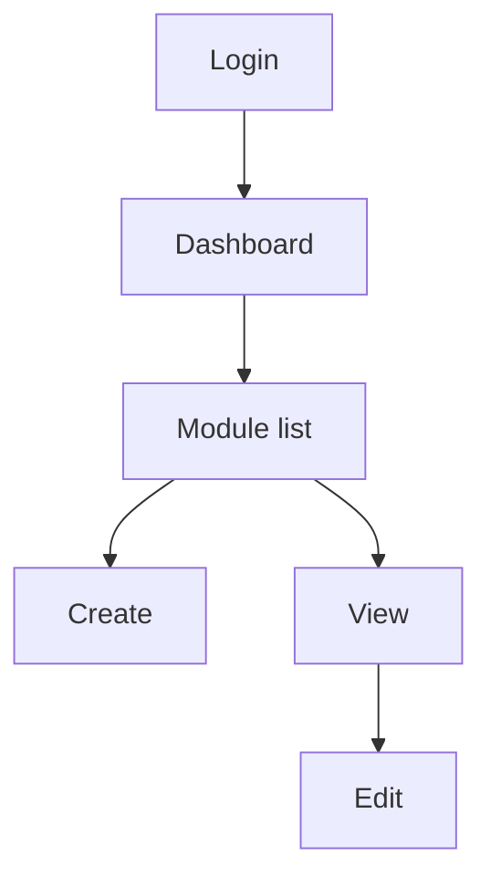

# [Project Name] — ADB 05: Frontend Specification

> **Application Design Book (ADB) — Book 5 of 5.** Design tokens (shadcn/ui), sitemap (file tree + JSON), screens, folder structure, API layer, and frontend conventions for Next.js + shadcn/ui + Tailwind CSS + ESLint.
> Guideline: `guidelines/05-FRONTEND-SPEC.guide.md`. Replace every `[placeholder]`. Use `N/A — reason` and `TBD — see Q-xx`.
> **Fixed conventions** (sections 2, 3.1, and 8–10) are pre-filled. Change them only through an ADR in ADB 02.

---

## 0. Document Info

| Field | Value |
|---|---|
| Project name | [Name] |
| Project code | [Code] |
| Book | ADB 05 — Frontend Spec |
| Version | [0.1.0] |
| Status | [Draft / In Review / Approved / Deprecated] |
| Author(s) | [Name, role] |
| Reviewer(s) | [Name, role] |
| Created | [YYYY-MM-DD] |
| Last updated | [YYYY-MM-DD] |
| Repository | [URL] |
| Figma / design file | [URL] |

### Change Log

| Version | Date | Author | Summary of changes |
|---|---|---|---|
| 0.1.0 | [YYYY-MM-DD] | [Name] | Initial draft |

---

## 1. Tech Summary

| Item | Value |
|---|---|
| Framework | Next.js [version], App Router |
| Language | TypeScript [version], `strict: true` |
| UI kit | shadcn/ui ([style], base color [neutral / zinc / slate]) |
| Styling | Tailwind CSS [v4] |
| Lint / format | ESLint [version] ([config]) + [Prettier] |
| Auth | NextAuth (`src/auth.ts`) |
| Forms | [react-hook-form + zod] |
| Server state | [TanStack Query / fetch + server actions] |
| Icons | [lucide-react] |
| Tables | [TanStack Table via shadcn data table] |
| Dates | [date-fns / dayjs] |
| i18n | [next-intl / none] — languages: [en, th] |
| Package manager | [pnpm / npm] |

---

## 2. Folder Structure (fixed pattern)

> **Rule:** business UI lives in `src/feature/`. `src/components/` holds only generic, business-free UI. If a component knows about a module (project, invoice…), it belongs in `feature/`.

### 2.1 Repository Tree

```text
[project]-FE/
├── .claude/skills/                  # AI agent skills
├── dev/docs/                        # Developer guides
├── public/                          # Static assets, service worker
├── src/
│   ├── auth.ts                      # NextAuth config
│   ├── app/                         # Next.js App Router — routing only, no business UI
│   │   ├── layout.tsx · page.tsx · error.tsx · not-found.tsx · loading.tsx
│   │   ├── api/<route>/route.ts     # Route handlers (auth callbacks, proxies)
│   │   └── <scope>/                 # e.g. admin/, me/
│   │       └── <module>/
│   │           ├── layout.tsx
│   │           ├── page.tsx                     # → feature/<module>/search
│   │           ├── create/page.tsx              # → feature/<module>/create
│   │           └── [<module>Id]/
│   │               ├── page.tsx                 # → feature/<module>/view
│   │               ├── edit/page.tsx            # → feature/<module>/edit
│   │               └── <submodule>/
│   │                   ├── page.tsx
│   │                   └── [<submodule>Id]/page.tsx
│   │
│   ├── components/                  # Generic UI, no business logic
│   │   ├── ui/                      # shadcn/ui generated components (do not hand-edit API)
│   │   ├── primitive/<component>/   # Atoms built on shadcn (chip, statusDot…)
│   │   ├── form/<component>/        # Inputs (textField, select, datePicker…)
│   │   ├── complex/<component>/     # Heavy widgets (dataGrid, kanban, textEditor…)
│   │   └── featureUi/<component>/   # Shared app-level pieces (pageHeader, emptyState…)
│   │
│   ├── feature/                     # Business features
│   │   ├── <module>/
│   │   │   ├── create/
│   │   │   ├── edit/
│   │   │   ├── search/
│   │   │   ├── view/
│   │   │   ├── viewDrawer/
│   │   │   ├── summary/
│   │   │   └── <submodule>/
│   │   │       ├── create/ · edit/ · search/ · view/ · viewDrawer/
│   │   └── share/<component>/       # Domain components shared across modules
│   │
│   ├── dataProvider/<scope>/        # Scoped context providers
│   │   ├── <Scope>Data.provider.tsx
│   │   ├── <scope>Data.service.ts
│   │   └── <scope>Data.type.ts
│   ├── hooks/                       # Core hooks (useEditData, useUrlSearch…)
│   ├── libs/
│   │   ├── api/<module>/<submodule>/<action><Entity>.ts   # API wrappers
│   │   ├── api/client.ts            # fetch wrapper, auth header, envelope parsing
│   │   ├── options/                 # Static option lists
│   │   └── utils/<category>/        # Helpers (date, number, export…)
│   ├── navigation/<scope>/          # Sidebar / navbar configs
│   ├── context/                     # Global providers (theme, session, query client)
│   ├── style/                       # globals.css: Tailwind v4 theme + shadcn tokens
│   └── types/                       # Global TypeScript types (ApiResponse mirrors ADB 04 §4)
├── components.json                  # shadcn config
├── eslint.config.mjs
├── AGENTS.md · CLAUDE.md · README.md
└── next.config.ts · tsconfig.json · package.json
```

### 2.2 Feature Folder Contents

```text
feature/<module>/<action>/
├── <Module><Action>.tsx             # Main component, e.g. ProjectSearch.tsx
├── <module><Action>.hook.ts         # State + data logic, e.g. projectSearch.hook.ts
├── <module><Action>.type.ts         # Local types
├── <module><Action>.schema.ts       # Zod form schema (create / edit only)
├── <module><Action>.column.tsx      # Table columns (search only)
└── components/                      # Pieces used only by this action
```

| Action folder | Renders | Calls API |
|---|---|---|
| `search/` | List / table + filters | `search<Entity>` |
| `create/` | Create form | `create<Entity>` |
| `edit/` | Edit form | `get<Entity>`, `edit<Entity>` |
| `view/` | Full detail page | `get<Entity>` |
| `viewDrawer/` | Detail in a side drawer | `get<Entity>` |
| `summary/` | Dashboard cards / stats | [summary endpoint] |

### 2.3 Feature Index

| Feature folder | Module code | Actions present | Route(s) | Owner |
|---|---|---|---|---|
| `feature/[module]/` | [CODE] | [search, create, edit, view] | [/admin/[module]] | [Name] |

---

## 3. Design Tokens (shadcn/ui)

### 3.1 Token Rules (fixed)
1. Components use semantic Tailwind classes only (`bg-primary`, `text-muted-foreground`, `border-border`). No hex, rgb, or Tailwind palette colors (`bg-blue-500`) in components.
2. Every surface token has a `-foreground` pair. Text on a surface always uses its pair.
3. Tokens are defined once in `src/style/globals.css`: values in `:root` and `.dark`, mapped to Tailwind in `@theme inline`.
4. Values use `oklch()`.
5. New tokens follow the shadcn naming pattern and are added to this section before use.
6. Text/background pairs must meet contrast 4.5:1 (body) and 3:1 (large text, UI borders).

### 3.2 Color Tokens

| CSS variable | Tailwind class | Light | Dark | Usage |
|---|---|---|---|---|
| `--background` | `bg-background` | [oklch(…)] | [oklch(…)] | Page background |
| `--foreground` | `text-foreground` | | | Default text |
| `--card` | `bg-card` | | | Cards |
| `--card-foreground` | `text-card-foreground` | | | Text on cards |
| `--popover` | `bg-popover` | | | Popovers, menus |
| `--popover-foreground` | `text-popover-foreground` | | | |
| `--primary` | `bg-primary` | | | Primary actions |
| `--primary-foreground` | `text-primary-foreground` | | | Text on primary |
| `--secondary` | `bg-secondary` | | | Secondary actions |
| `--secondary-foreground` | `text-secondary-foreground` | | | |
| `--muted` | `bg-muted` | | | Subtle backgrounds |
| `--muted-foreground` | `text-muted-foreground` | | | Helper / placeholder text |
| `--accent` | `bg-accent` | | | Hover, selected rows |
| `--accent-foreground` | `text-accent-foreground` | | | |
| `--destructive` | `bg-destructive` | | | Delete, errors |
| `--border` | `border-border` | | | Borders, dividers |
| `--input` | `border-input` | | | Input borders |
| `--ring` | `ring-ring` | | | Focus ring |
| `--chart-1` … `--chart-5` | `fill-chart-1` … | | | Chart series |
| `--sidebar` | `bg-sidebar` | | | Sidebar background |
| `--sidebar-foreground` | `text-sidebar-foreground` | | | |
| `--sidebar-primary` | `bg-sidebar-primary` | | | Active nav item |
| `--sidebar-primary-foreground` | `text-sidebar-primary-foreground` | | | |
| `--sidebar-accent` | `bg-sidebar-accent` | | | Nav hover |
| `--sidebar-accent-foreground` | `text-sidebar-accent-foreground` | | | |
| `--sidebar-border` | `border-sidebar-border` | | | |
| `--sidebar-ring` | `ring-sidebar-ring` | | | |

### 3.3 Extended Color Tokens (project-specific)

| CSS variable | Tailwind class | Light | Dark | Usage |
|---|---|---|---|---|
| `--success` / `--success-foreground` | `bg-success` | | | Success states |
| `--warning` / `--warning-foreground` | `bg-warning` | | | Warnings |
| `--info` / `--info-foreground` | `bg-info` | | | Info |
| [`--status-<name>`] | | | | [Status chips mapped to enums in ADB 03] |

### 3.4 Status Color Mapping

| Enum (ADB 03) | Value | Token | Label |
|---|---|---|---|
| [project_status] | [active] | [success] | [Active] |

### 3.5 Typography

| Token | Tailwind class | Font | Size / line height | Weight | Usage |
|---|---|---|---|---|---|
| `--font-sans` | `font-sans` | [Inter, Noto Sans Thai] | — | — | UI text |
| `--font-mono` | `font-mono` | [JetBrains Mono] | — | — | Code, IDs |
| Display | [`text-4xl`] | sans | [36 / 40] | [700] | [Hero] |
| H1 | [`text-3xl`] | sans | | | Page title |
| H2 | [`text-2xl`] | | | | Section title |
| H3 | [`text-xl`] | | | | Card title |
| Body | [`text-sm`] | | | [400] | Default |
| Small | [`text-xs`] | | | | Captions, meta |

### 3.6 Radius, Spacing, Shadow, Breakpoints, Z-index, Motion

| Token | Value | Tailwind | Usage |
|---|---|---|---|
| `--radius` | [0.625rem] | base | Base radius |
| radius-sm / md / lg / xl | `calc(var(--radius) ± …)` | `rounded-sm` … `rounded-xl` | |
| Spacing scale | Tailwind default (4px step) | `p-1` … | Allowed steps: [1, 2, 3, 4, 6, 8, 12] |
| Page gutter | [16px mobile / 24px desktop] | [`px-4 md:px-6`] | |
| Shadow | [sm, md] | `shadow-sm` | Cards / popovers |
| Breakpoints | sm 640 · md 768 · lg 1024 · xl 1280 · 2xl 1536 | `md:` … | |
| Z-index | [dropdown 50, drawer 60, modal 70, toast 80] | | |
| Motion | [150ms ease-out / 250ms] | `duration-150` | Respect `prefers-reduced-motion` |

### 3.7 globals.css Skeleton

```css
/* src/style/globals.css */
@import "tailwindcss";
@import "tw-animate-css";

@custom-variant dark (&:is(.dark *));

:root {
  --radius: [0.625rem];
  --background: [oklch(1 0 0)];
  --foreground: [oklch(0.145 0 0)];
  --primary: [oklch(…)];
  --primary-foreground: [oklch(…)];
  /* … every token in §3.2 and §3.3 */
}

.dark {
  --background: [oklch(0.145 0 0)];
  --foreground: [oklch(0.985 0 0)];
  /* … */
}

@theme inline {
  --color-background: var(--background);
  --color-foreground: var(--foreground);
  --color-primary: var(--primary);
  --color-primary-foreground: var(--primary-foreground);
  /* … one mapping per token */
  --radius-sm: calc(var(--radius) - 4px);
  --radius-md: calc(var(--radius) - 2px);
  --radius-lg: var(--radius);
  --radius-xl: calc(var(--radius) + 4px);
}
```

---

## 4. Sitemap

### 4.1 Route Tree (App Router)

```text
src/app/
├── page.tsx                                   # / — [landing / redirect]
├── login/page.tsx                             # /login
├── [scope]/
│   ├── layout.tsx                             # Scope shell (sidebar, auth guard)
│   ├── page.tsx                               # /[scope] — dashboard
│   └── [module]/
│       ├── page.tsx                           # /[scope]/[module] — search
│       ├── create/page.tsx                    # /[scope]/[module]/create
│       └── [[module]Id]/
│           ├── page.tsx                       # /[scope]/[module]/:[module]Id — view
│           ├── edit/page.tsx                  # /[scope]/[module]/:[module]Id/edit
│           └── [submodule]/
│               ├── page.tsx                   # list of submodule
│               └── [[submodule]Id]/page.tsx   # submodule view
└── not-found.tsx
```

### 4.2 Sitemap JSON

```json
{
  "version": "[0.1.0]",
  "routes": [
    {
      "id": "SC-01",
      "path": "/[scope]/[module]",
      "title": "[Module list]",
      "scope": "[admin]",
      "module": "[CODE]",
      "action": "search",
      "page": "src/app/[scope]/[module]/page.tsx",
      "feature": "src/feature/[module]/search",
      "roles": ["ROLE-01"],
      "inNav": true,
      "children": [
        {
          "id": "SC-02",
          "path": "/[scope]/[module]/create",
          "title": "[Create module]",
          "scope": "[admin]",
          "module": "[CODE]",
          "action": "create",
          "page": "src/app/[scope]/[module]/create/page.tsx",
          "feature": "src/feature/[module]/create",
          "roles": ["ROLE-01"],
          "inNav": false,
          "children": []
        }
      ]
    }
  ]
}
```

### 4.3 Sitemap Diagram



---

## 5. Screens

### 5.1 Screen List

| Screen ID | Screen | Route | Feature folder | Roles | Feature (BRD) | Design link |
|---|---|---|---|---|---|---|
| SC-01 | [Project list] | /[scope]/[module] | feature/[module]/search | [ROLE-xx] | F-[CODE]-xx | [URL] |

### 5.2 Screen Detail

> Repeat for every screen in 5.1.

#### SC-[NN]: [Screen name]

| Field | Value |
|---|---|
| Route | [/admin/project/:projectId] |
| Page file | `src/app/[…]/page.tsx` |
| Feature | `src/feature/[module]/[action]/` |
| Layout | [Scope shell / full-width / drawer] |
| Roles | [ROLE-xx] |
| Purpose | [What the user does here] |

**API calls**

| Wrapper (`libs/api`) | Endpoint (ADB 04) | When |
|---|---|---|
| `search[Entity]` | `POST /api/v1/[module]/search` | [On load, on filter change] |

**UI elements**

| Element | Component | Behavior |
|---|---|---|
| [Filter bar] | [`form/select`, `form/textField`] | [Syncs to URL via `useUrlSearch`] |
| [Table] | [`complex/dataGrid`] | [Server pagination; row click → viewDrawer] |
| [Primary action] | [`ui/button` default] | [→ create page] |

**States**

| State | What the user sees |
|---|---|
| Loading | [Skeleton rows] |
| Empty | [`featureUi/emptyState` + create CTA] |
| Error | [Inline alert with retry; toast by `code`] |
| No permission | [Redirect to 403 / hide action] |

**Form fields** *(create / edit only)*

| Field | Component | Required | Validation | Maps to `data.` (ADB 04) |
|---|---|---|---|---|
| [Name] | [`form/textField`] | Yes | [1–200 chars] | [name] |

---

## 6. Navigation

| Scope | Config file | Item | Route | Icon | Roles | Order |
|---|---|---|---|---|---|---|
| [admin] | `navigation/admin/admin.nav.ts` | [Projects] | /admin/project | [FolderKanban] | [ROLE-xx] | [1] |

---

## 7. Components Inventory

### 7.1 shadcn/ui Components Installed

| Component | Installed via | Customized? | Notes |
|---|---|---|---|
| [button] | `npx shadcn@latest add button` | [No / variants added: …] | |

### 7.2 Custom Components

| Component | Folder | Built on | Variants / props | Used by |
|---|---|---|---|---|
| [statusChip] | `components/primitive/statusChip/` | [badge] | [status: enum] | [feature/…] |

---

## 8. API Layer (fixed pattern)

| Rule | Detail |
|---|---|
| Location | `src/libs/api/<module>/<submodule>/<action><Entity>.ts` — one file per endpoint |
| Naming | `searchProject.ts`, `createProject.ts`, `getProject.ts`, `editProject.ts`, `deleteProject.ts` |
| Client | All wrappers call `libs/api/client.ts`, which adds the auth header and parses the envelope |
| Types | `ApiResponse<T>`, `SearchBody<F>`, `CreateBody<T>`, `EditBody<T>` in `src/types/api.types.ts` (mirror ADB 04 §3–4) |
| Errors | `success: false` → throw `ApiError(code, message, data)`; UI maps `code` to a message or field errors |
| Search state | Filters, sort, and page live in the URL (`useUrlSearch`) so lists are shareable and survive refresh |

```ts
// src/libs/api/project/searchProject.ts
import { apiClient } from '@/libs/api/client';
import type { ApiResponse, SearchBody } from '@/types/api.types';
import type { Project, ProjectFilter } from '@/types/project.types';

export const searchProject = (body: SearchBody<ProjectFilter>) =>
  apiClient.post<ApiResponse<Project[]>>('/api/v1/project/search', body);
```

```ts
// src/libs/api/project/milestone/editMilestone.ts
export const editMilestone = (projectId: string, milestoneId: string, data: Partial<MilestoneInput>) =>
  apiClient.put<ApiResponse<Milestone>>(`/api/v1/project/${projectId}/milestone/${milestoneId}/edit`, { data });
```

### 8.1 Error Code → UI Mapping

| Code (ADB 04) | UI behavior |
|---|---|
| VALIDATION_ERROR | Map `data.errors[].path` to form fields |
| UNAUTHENTICATED | Sign out and redirect to /login |
| FORBIDDEN | Toast "You don't have permission" |
| [MODULE_NOT_FOUND] | Redirect to list with toast |
| INTERNAL_ERROR | Toast with retry |

---

## 9. State, Forms & Auth (fixed pattern)

| Concern | Rule |
|---|---|
| Server data | [TanStack Query] keys: `[module, action, params]` |
| Scoped data | `dataProvider/<scope>/` for data shared by a whole scope (current user, org, permissions) |
| Global UI state | `context/` (theme, toasts) only |
| Forms | react-hook-form + zod schema in `<module><Action>.schema.ts`; schema mirrors the backend validation |
| Route protection | Scope `layout.tsx` checks the session (NextAuth); actions hidden by role from `dataProvider` permissions |
| Server vs client | Pages are Server Components; feature components that need state use `'use client'` |

---

## 10. Conventions & ESLint (fixed pattern)

| Item | Rule |
|---|---|
| Folders | camelCase (`viewDrawer`, `featureUi`) |
| Components | PascalCase file and export (`ProjectSearch.tsx`) |
| Hooks | `use<Name>` exported from `<name>.hook.ts` |
| Types | `<name>.type.ts`; exported types PascalCase |
| Imports | Absolute via `@/` |
| Import boundaries | `components/` must not import from `feature/`; `feature/<a>` must not import from `feature/<b>` (use `feature/share`) |
| ESLint config | `eslint.config.mjs`: `next/core-web-vitals`, `next/typescript`, [import order, boundaries rule] |
| Must pass in CI | `eslint .`, `tsc --noEmit`, build |

| ESLint rule | Setting | Why |
|---|---|---|
| [`no-restricted-imports`] | [block `@/feature/*` inside `components/`] | Keep components business-free |
| [`@typescript-eslint/no-explicit-any`] | [error] | Type safety |

---

## 11. Accessibility & Localization

| Item | Requirement |
|---|---|
| Target | [WCAG 2.2 AA] |
| Keyboard | All actions reachable; visible focus ring (`ring-ring`) |
| Labels | Every input has a label; icon buttons have `aria-label` |
| Touch targets | ≥ 44×44 px on mobile |
| Languages | [en, th] |
| Date / number format | [Locale, timezone display rule] |

---

## 12. Open Questions

| ID | Question | Raised by | Owner | Due | Answer |
|---|---|---|---|---|---|
| Q-01 | [Question] | [Name] | [Name] | [YYYY-MM-DD] | [Pending] |
